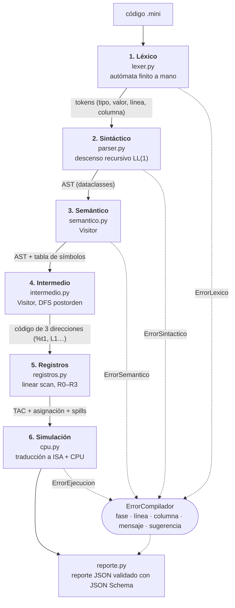
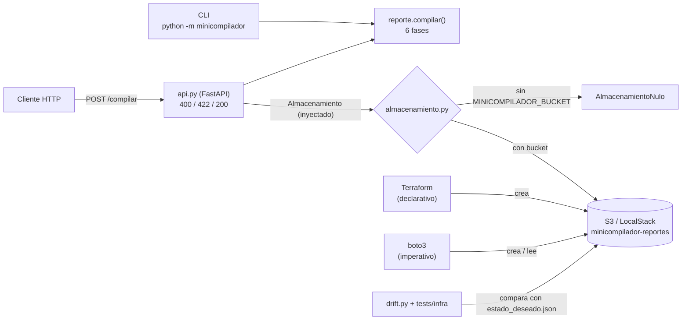
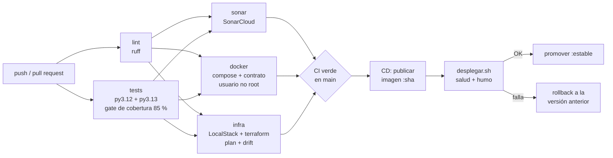

# Arquitectura

## 1. Diagrama de fases



`compilar()` en `reporte.py` ejecuta las fases en orden y se detiene en la
primera que lanza un `ErrorCompilador`. El reporte conserva lo que produjeron
las fases anteriores, y las secciones de las fases no alcanzadas quedan en
`null`. Así el JSON siempre tiene las mismas claves.

### Qué hace cada fase y por qué así

| Fase | Entrada → salida | Decisiones de diseño |
|---|---|---|
| 1. Léxico | texto → tokens | **Coincidencia más larga** (`<=` es un token, no `<` y `=`). Columnas 1-based que solo se actualizan en `_avanzar`, para evitar errores off-by-one. Clases de caracteres ASCII explícitas (`ñ` y `²` se rechazan). Regla de contexto para `%`: es error si lo sigue una letra y antes no hay un operando. Literales con rango comprobado: `int` ≤ 2147483647. |
| 2. Sintáctico | tokens → AST | Gramática EBNF en el docstring. **La precedencia sale del orden de las llamadas** (`expresion → comparacion → suma → termino → factor`) y la **asociatividad izquierda, de los bucles `while`**. Los relacionales no se encadenan (`a < b < c` es error). `PROFUNDIDAD_MAXIMA = 100`. El `-` unario se traduce a `0 - x`. |
| 3. Semántico | AST → tabla de símbolos + advertencias | Un solo ámbito global. Direcciones `1000 + 4·i`. Errores: variable no declarada, redeclaración, palabra reservada como nombre, tipos incompatibles (bool ↔ número). Advertencias: `FLOAT_A_INT`, `NO_INICIALIZADA`, `NO_USADA`, `CONDICION_NO_BOOLEANA`, `NOMBRE_BUILTIN`, `NOMBRE_CORTO` (una letra que no es contador de un `while`), `NO_SNAKE_CASE`. |
| 4. Intermedio | AST → TAC | Patrón **Visitor** con recorrido **DFS en postorden** (izquierda, derecha y después el nodo): los operandos están listos antes que la operación. Las temporales salen de `nueva_temporal()` (`%t1`, `%t2`…). **Plegado de constantes** (`2 * 3` → `6`), salvo división por cero o desbordamiento, para que el error aparezca al ejecutar con su línea. |
| 5. Registros | TAC → asignación | **Linear scan** (Poletto & Sarkar): calcula el intervalo de vida de cada temporal, libera los registros de las que murieron y asigna el libre de número más bajo. Sin registro libre hay **spill** a `MEM[2000 + 4·k]` y una advertencia `SPILL`. |
| 6. Simulación | TAC → ISA → ejecución | ISA: `LOAD STORE MOV ADD SUB MUL DIV MOD CMP JMP JZ JNZ PRINT HALT`. La memoria es un diccionario **tipado** (truncar al guardar en `int`, promover en `float`). Costo: 1 ciclo + 2 por acceso a memoria. Detecta la división por cero, el desbordamiento y el bucle infinito (límite de ciclos configurable). |

`operaciones.py` es la **única** implementación de los operadores. La usan el
plegado de constantes (fase 4) y la CPU (fase 6), de modo que optimizar nunca
cambia el resultado.

### Ejemplo: `c = a + b * (a - 2) % 3;`

```
AST (precedencia)            DFS postorden               TAC                 CPU (2 registros)
        +                    a, a, 2, -,                 %t1 = a - 2         LOAD R0, [a]
      /   \                  b, *, 3, %,                 %t2 = b * %t1       SUB  R0, R0, #2
     a     %                 a, +                        %t3 = %t2 % 3       LOAD R1, [b]
          / \                                            %t4 = a + %t3       MUL  R1, R1, R0
         *   3                                           c = %t4             MOD  R0, R1, #3
        / \                                                                  LOAD R1, [a]
       b   -                                                                 ADD  R1, R1, R0
          / \                                                                STORE [c], R1
         a   2
```

Las temporales `%t1` y `%t3` comparten `R0` porque `%t1` muere (su último uso es
en `%t2`) antes de que nazca `%t3`.

### Traducción de `if` y `while`

```
if (cond) { A } else { B }          while (cond) { C }
    %tN = cond                      L_inicio:
    ifFalse %tN goto L_sino             %tN = cond
    A                                   ifFalse %tN goto L_fin
    goto L_fin                          C
L_sino:                                 goto L_inicio
    B                               L_fin:
L_fin:
```

`ifFalse` se traduce a `JZ` (salta si el valor es 0) y `CMP` escribe 1 o 0
según la condición (`LT GT LE GE EQ NE`).

## 2. Componentes en ejecución



* La API recibe el almacenamiento por **inyección de dependencias**. Las
  pruebas inyectan dobles (`Stubber` de botocore, un fake en memoria o uno que
  siempre falla).
* Si S3 falla, el cliente recibe su reporte igual (**degradación elegante**). El
  resultado del guardado va en las cabeceras `X-Reporte-Clave` /
  `X-Reporte-Guardado`, para no tocar el contrato JSON.

## 3. Pipeline CI/CD



## 4. Imagen Docker (multi-stage)

```
constructor  python:3.12-slim + venv + pip install ".[api,s3]"
     │  COPY --from=constructor /opt/venv
     ▼
produccion   python:3.12-slim + venv, usuario uid 10001, HEALTHCHECK /salud, sin pip cache ni código fuente
contrato     python:3.12-slim + pytest/requests/jsonschema + tests/api (lo usa el servicio test-runner)
```
